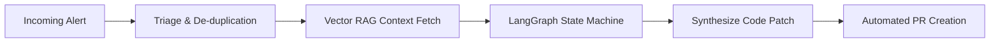

# Sentinel AI Architecture Specification

## Overview
Sentinel AI orchestrates multi-agent incident response using:
1. **LangGraph State Machine**: State transitions through triage, investigation, fix synthesis, and verification.
2. **PostgreSQL + pgvector**: Stores historical incident post-mortems and semantic codebase embeddings.
3. **Google Gemini LLM**: Performs high-fidelity reasoning over execution traces and source diffs.

